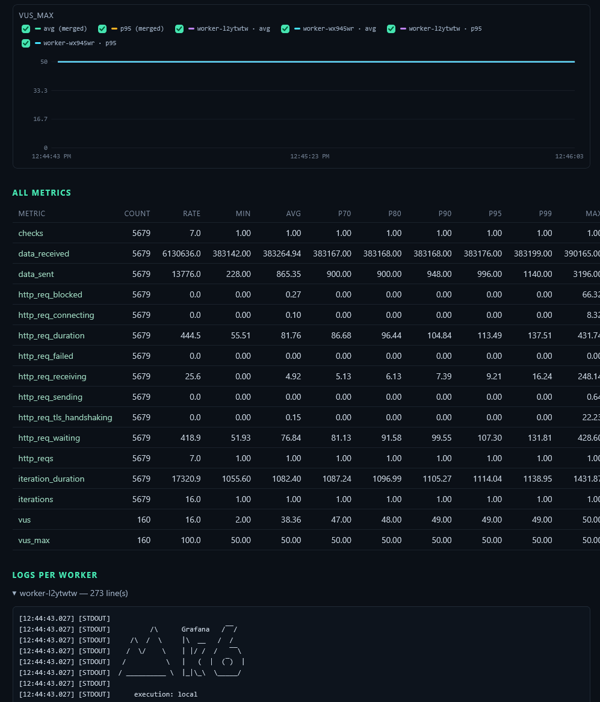

# k6-simple-distributed

A streamlined k6 test orchestrator with simplified workers designed for resource-constrained environments.

No kubernetes needed, only nodejs.
You can run your tests via a web ui or via an API.




## Logic / objectives

Read the [doc](./docs/architecture.md)

## Setup

Read the [guide](./docs/setup.md)

## Run Commands per OS

Configuration is done with environment variables: `ORCHESTRATOR_URL`, `WORKER_ID`, `PORT`, and optionally `WORKER_TMP_DIR` — the worker's ephemeral test-files directory (default: the OS temp dir).

### Running on Windows

#### Option A: via PowerShell (recommended on Windows)

* **For the Orchestrator:**
  ```powershell
  $env:PORT="3000"
  node orchestrator.js
  ```
* **For a Worker (Agent):**
  ```powershell
  $env:ORCHESTRATOR_URL="http://<IP_ORCHESTRATOR>:3000"
  $env:WORKER_ID="worker-windows-01"
  $env:PORT="4000"
  # $env:WORKER_TMP_DIR="D:\k6-worker-tmp"   # optional (default: OS temp dir)
  node worker.js
  ```

#### Option B: via the classic Command Prompt (cmd.exe)

```cmd
:: For the Orchestrator
set PORT=3000
node orchestrator.js

:: For a Worker (Agent)
set ORCHESTRATOR_URL=http://<IP_ORCHESTRATOR>:3000
set WORKER_ID=worker-windows-01
set PORT=4000
:: set WORKER_TMP_DIR=D:\k6-worker-tmp   (optional, default: OS temp dir)
node worker.js
```

---

### Running on Linux and macOS

* **For the Orchestrator:**
  ```bash
  PORT=3000 node orchestrator.js
  ```
* **For a Worker (Agent):**
  ```bash
  ORCHESTRATOR_URL="http://<IP_ORCHESTRATOR>:3000" WORKER_ID="worker-linux-01" PORT=4000 node worker.js
  # optional: WORKER_TMP_DIR=/tmp/k6-worker-tmp (default: OS temp dir)
  ```

Then, from the Orchestrator's browser, open **`http://localhost:3000`** for
the web console — or, via the API, trigger the one-shot demo test:
```shell
node orchestrator/test/trigger.api.js
```

To smoke-test the whole orchestrator API (worker selection + start/stop), run
the ready-to-run E2E fixtures: `node orchestrator/test/e2e/run.js` (see
`orchestrator/test/e2e/README.md` for what each case covers).

To run a **named scenario** end to end — pick an id, launch it via the API,
stream every selected worker's live k6 logs on the console, wait for it to
finish, then archive `report.json` + `report.html` + a `manifest.md` under
`tmp/<id>_<name>_<timestamp>/` — use the scenario runner (see `cli/README.md`):
```shell
node cli/scenario-runner.js --scenarios orchestrator/test/scenarios.tests.json         # interactive (prompt for an id)
node cli/scenario-runner.js --id 2 --scenarios orchestrator/test/scenarios.tests.json  # non-interactive
```
Scenarios live in `orchestrator/test/scenarios.tests.json` — the file is
**required**, passed with `--scenarios <path>` (no default). Each scenario
carries its load profile in `options` (a single k6 v2 scenario definition,
e.g. `{ "executor": "constant-vus", "vus": 50, "duration": "50s" }`), an
optional `env` (a **sibling** of `options`, not a k6 field — data files are
uploaded to the workers and passed as `__ENV` vars, e.g. `CSV_FILE_PATH`), and
the script it targets. The runner wraps the single scenario under the
`default` name into the `scenarios` map the API expects (`scenarioOptions`),
which splits it over the workers and sends each its share as the
`K6_SCENARIO_OPTIONS` `__ENV` variable (the script reads it with
`options.scenarios = JSON.parse(__ENV.K6_SCENARIO_OPTIONS)`).

---

## Web console & API

At startup, the orchestrator serves the web console on
**`http://<IP_ORCHESTRATOR>:3000`** — a React / Next.js application (`web/`
folder, component split in `web/README.md`), whose static build (`web/out`)
is served by Express on the same origin as the API and Socket.io. It lets you:

* **Watch live charts** (k6 web-dashboard style): summary cards (VUS, req/s,
  failed/s, checks %, iterations/s, data received/sent) with sparklines, then
  per-second charts (req/s + failed/s, data B/s, VUS, checks %). Every chart
  draws the **fusion curve** (all workers) **and one curve per worker**
  (dashed); checkboxes + a global **Curves** mode (Merged / Per worker / All,
  default Merged) control which series are shown. The displayed VUS are the
  **sum of every worker's active VUS**.
* **Explore metrics**: every k6 metric (e.g. `http_req_duration`) gets an
  avg + p95 chart and a statistics table (count, rate, avg,
  p70/p80/p90/p95/p99, min, max) with one row per source (fusion + one per
  worker).
* **Inspect per-worker logs**: one tab per worker (no concatenation),
  millisecond timestamps, `STDOUT`/`STDERR`.
* **Start a test**: k6 script **pasted** or **pointed to by a `.js` path**
  (read on the orchestrator's machine, then injected as-is to the targeted
  workers), **targeted workers** (per-worker checkboxes, default all,
  All / None), **load profile** (the k6 v2 `scenarios` map as JSON — split
  over the targeted workers and sent to each as the `K6_SCENARIO_OPTIONS`
  `__ENV` variable), optional **data files** (uploaded next to the ephemeral
  script so relative paths in the script, e.g. `open('./data.csv')`, work as
  in a local run) — and **stop** a test as an emergency stop. The pasted
  **Script k6** (JS) and **Load profile** (JSON) inputs are live-linted
  (syntax + shape) as you type.
* **Download the session report** (the 10 most recent sessions stay selectable
  in the "Report" strip):
  * **`.html`** — self-contained page: interactive SVG charts for the main
    series and every metric (avg + p95), fusion + per-worker curves with
    show/hide checkboxes, all-metrics table, per-worker logs; opens in a
    browser, no server required.
  * **`.json`** — full report: totals, final statistics for every metric
    (percentiles included), per-second timestamped series (per-worker values
    in `byWorker`), final statistics per worker, per-worker logs.
  * **`.txt`** — human-readable summary (session, exit code per worker,
    per-worker metrics, global summary, logs).
  * **Raw k6 JSON (`.jsonl`)** — the raw `--out json=` output of every worker
    (JSON Lines), re-downloadable per session and per worker.
* **Follow worker state** (Available / Busy) in real time.

Behind the live charts: the worker streams k6's raw data points
(`worker:metrics`); the orchestrator aggregates them **in memory** — globally
(fusion) and per worker — and broadcasts a snapshot per second
(`ui:metrics`); k6 console logs keep arriving via `worker:log` (see
`docs/architecture.md` §5).

### HTTP API (reports & sessions)

| Method | Route                        | Description                                                        |
|--------|------------------------------|------------------------------------------------------------------|
| GET    | `/api/test/sessions`         | The 10 most recent sessions (status, VUS, duration, max VUS, workers) |
| GET    | `/api/test/report`           | JSON report of the running session (or the last one)              |
| GET    | `/api/test/report?format=txt`| Text report (summary) of the running session                       |
| GET    | `/api/test/report?format=html`| Self-contained HTML report                                  |
| GET    | `/api/test/report?session=`  | Report of a specific session (id `sess-…`)                        |
| GET    | `/api/raw-metrics`           | Raw k6 JSON of a worker (`?session=&worker=`, JSON Lines)         |
| POST   | `/api/test/start`            | Start a distributed test (optional `workerIds`, `attachments` data files) |
| POST   | `/api/test/stop`             | Emergency stop of all tests                                       |

> **Note:** only one test runs at a time. If a session is still in progress
> (e.g. after an emergency stop, as long as k6 has not emitted its exit code),
> `POST /api/test/start` answers `409`.
