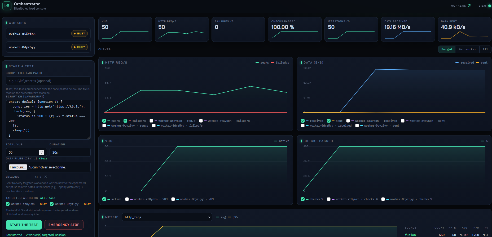
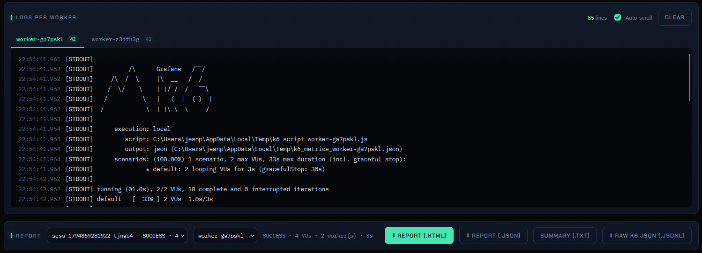
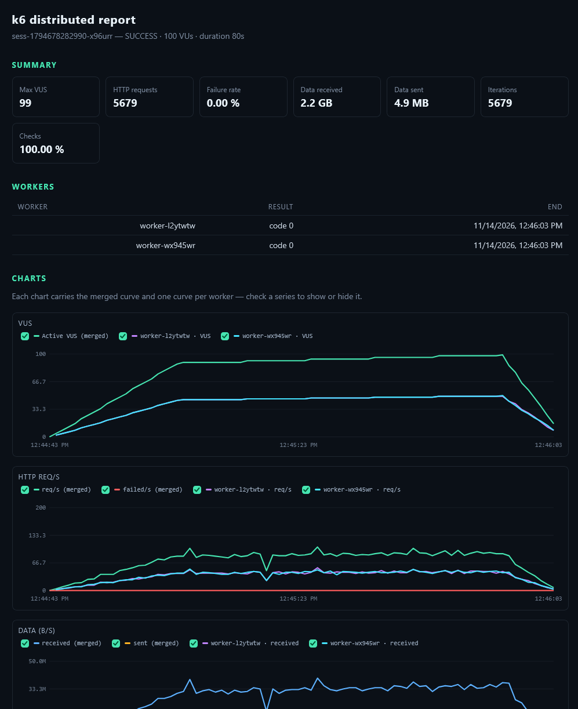
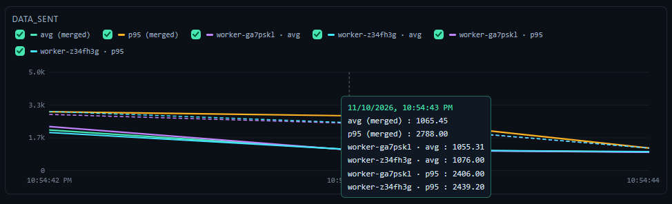
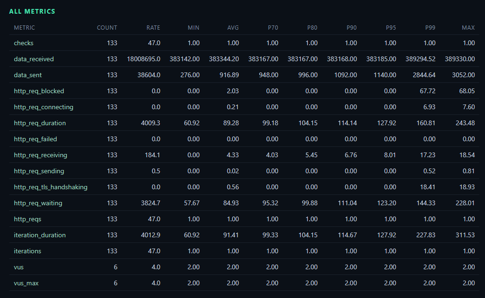

# k6-simple-distributed

A streamlined k6 test orchestrator with simplified workers designed for resource-constrained environments.

No kubernetes needed, only nodejs.
You can run your tests via a web ui or via an API.











## Logic / objectives

Read the [doc](./docs/architecture.md)

## Setup

Read the [guide](./docs/setup.md)

## Run Commands per OS

To set the environment variables (`ORCHESTRATOR_URL`, `WORKER_ID`, `PORT`), the syntax varies with the operating system and the terminal used.

### Running on Windows

#### Option A: via PowerShell (recommended on Windows)
In PowerShell, the environment variables must be defined on separate lines before running the script:

* **For the Orchestrator:**
  ```powershell
  $env:PORT="3000"
  node orchestrator.js
  ```
* **For a Worker (Agent):**
  ```powershell
  $env:ORCHESTRATOR_URL="http://<IP_ORCHESTRATEUR>:3000"
  $env:WORKER_ID="worker-windows-01"
  $env:PORT="4000"
  node worker.js
  ```

#### Option B: via the classic Command Prompt (cmd.exe)
```cmd
:: For the Orchestrator
set PORT=3000
node orchestrator.js

:: For a Worker (Agent)
set ORCHESTRATOR_URL=http://<IP_ORCHESTRATEUR>:3000
set WORKER_ID=worker-windows-01
set PORT=4000
node worker.js
```

---

### Running on Linux and macOS

On Unix-like systems (Bash / Zsh) you can declare the environment variables on the same line, just before the Node command.

* **For the Orchestrator:**
  ```bash
  PORT=3000 node orchestrator.js
  ```

* **For a Worker (Agent):**
  ```bash
  ORCHESTRATOR_URL="http://<IP_ORCHESTRATEUR>:3000" WORKER_ID="worker-linux-01" PORT=4000 node worker.js
  ```

---

### Test run

* **For the Orchestrator:**
```shell
node \orchestrator\orchestrator.js
```

* **For a Worker (Agent):**
```shell
node \worker\worker.js
```

Then, from the Orchestrator's browser, open **`http://localhost:3000`** (see section 5) —
or, via the API, you can trigger the demo test located here:
```shell
node \orchestrator\test\trigger.js
```

---

## Startup

At startup, the orchestrator serves the web console on **`http://<IP_ORCHESTRATEUR>:3000`**.
The console is a **React / Next.js** application (`web/` folder, split per
component — see §6.1): the static build (`web/out`) is served by Express, on
the same origin as the API and Socket.io. It lets you:

* **Watch live charts** (k6 web-dashboard style): summary cards
  (VUS, req/s, failed/s, checks %, iterations/s, data received/sent) with
  sparklines, then HTTP req/s + failed/s charts, data B/s, VUS and checks %.
  Each chart carries the **fusion curve** (all workers) **and one curve
  per worker** (dashed): **checkboxes** under each chart
  let you show/hide every series; hovering shows the value of every
  visible series at time t. A global **Curves** control
   (Merged / Per worker / All, default Merged) presets which curves are
   shown — a manual checkbox still wins per series.
* **Explore metrics**: a selector lists every metric produced by
  k6 (e.g. `http_req_duration`, `http_req_failed`…); for each one, an
  avg + p95 chart (fusion **and an avg/p95 curve per worker**) and a
  statistics table (count, rate, avg, p70/p80/p90/p95/p99, min, max) with **one row
  per source** (fusion + one per worker).
* **Inspect per-worker logs**: every agent has its own tab (no
  concatenation), with millisecond timestamps and `STDOUT`/`STDERR` type.
* **Start a test** (k6 script **pasted** or **pointed to by a `.js` path**,
  **targeted workers** — per-worker checkboxes, default all, *All / None*,
  total VUS, duration, optional **data files** (CSV, etc.)) and **stop** a
  test as an emergency stop, directly from the interface. The path is read on
  the orchestrator's machine, then injected as-is to the targeted workers;
  the data files are uploaded to the workers' tmp dir, next to the script, so
  relative paths in the script (e.g. `open('./data.csv')`) work as in a local
  run.
* **Download the session report**:
  * **`.html`** — a **self-contained** page: interactive SVG charts (with a tooltip showing
    the value at time t on hover) for the main series **and every metric**
    (avg + p95), with the fusion curve **and one curve per worker** — checkboxes
    per chart to show/hide every series. Summary,
    **all-metrics** table (count, rate, min, avg, p70/p80/p90/p95/p99, max), and
    per-worker logs. Opens in a browser, no server required.
  * **`.json`** — the full report: totals (requests, failed %, data, checks),
    final statistics for every metric (percentiles included), the
    per-second timestamped series (reconstructable as charts, with the **per
    worker** values in `byWorker`), the final statistics **per worker**, and the
    per-worker logs.
  * **`.txt`** — the human-readable summary (session, exit code per worker, **per-worker
    metrics** (VUS, requests, failures, data, iterations), global summary, metrics,
    logs).
  * **`Raw k6 JSON` (`.jsonl`)** — the raw `--out json=` output of every worker,
    line by line (metadata + data points, JSON Lines format), re-downloadable
    per session **and per worker** via the "Report" strip selector.

  The 10 most recent sessions stay selectable in the dropdown of the
  "Report" strip.
* **Follow worker state** (Available / Busy) in real time.

### Raw k6 metrics (`worker:metrics`)

To feed the charts, the worker runs k6 with **`--out json=<ephemeral
file>`**: every k6 data point (one JSON line per request/metric)
is re-read line by line by the worker, then streamed to the orchestrator via the
`worker:metrics` socket event (`{ data: [ { metric, data: { value, count } } ] }`).
The orchestrator aggregates the values (rate/second, min/max, percentiles over a
sliding window of 5,000 values) **globally (fusion of every worker) and per
worker**, and broadcasts a snapshot per second (`ui:metrics`) to the console: it carries
the fusion curve **and one curve per worker**, with the show/hide
checkboxes. The displayed VUS are the **sum of every worker's active VUS**.
k6 console logs keep arriving via `worker:log`.

### Additional HTTP API (reports & sessions)

| Method | Route                        | Description                                                        |
|--------|------------------------------|------------------------------------------------------------------|
| GET    | `/api/test/sessions`         | List of the 10 most recent sessions (status, VUS, duration, max VUS, workers) |
| GET    | `/api/test/report`           | JSON report of the running session (or the last one)             |
| GET    | `/api/test/report?format=txt`| Text report (summary) of the running session                       |
| GET    | `/api/test/report?format=html`| Self-contained HTML report (SVG charts + every metric)       |
| GET    | `/api/test/report?session=`  | Report of a specific session (id `sess-…`)               |
| GET    | `/api/raw-metrics`           | Raw k6 JSON output of a worker (`?session=&worker=`, JSON Lines) |
| POST   | `/api/test/start`            | Start a distributed test (optional `workerIds`, optional `attachments` data files; 409 if a test is already running) |
| POST   | `/api/test/stop`             | Emergency stop of all tests                                  |

> **Note:** only one test runs at a time. If a session is still in progress
> (e.g. after an emergency stop, as long as k6 has not emitted its exit code),
> `POST /api/test/start` answers `409`.